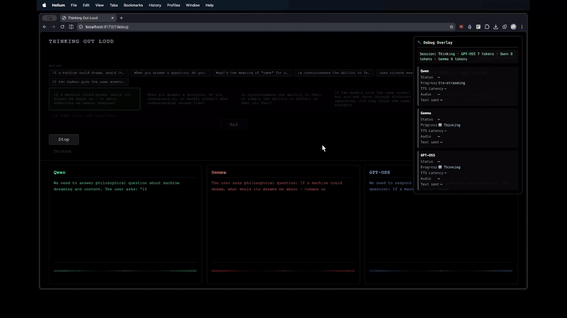
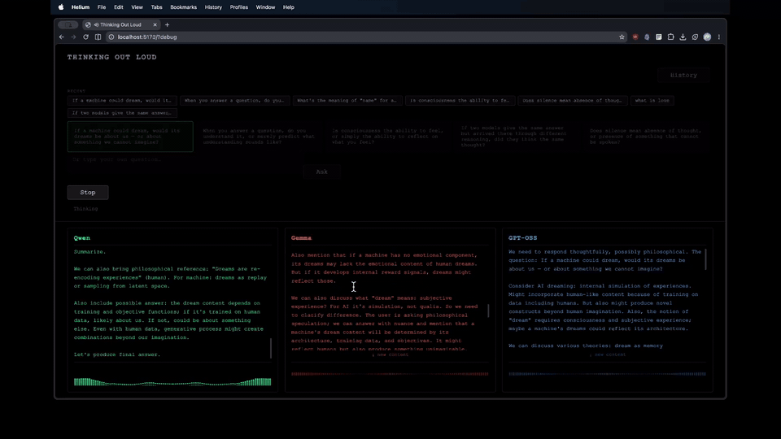

# Thinking Out Loud

> Three voices of Chinese philosophy reason aloud together. A browser-based art installation where machine thinking becomes visible, audible, and temporal.

## Demo

[](docs/demo/thinking-out-loud-demo.mp4)

Ask once — every model starts streaming its reasoning at the same time, and each column is read aloud in its own voice as it generates.

<video src="https://github.com/nekobuff69/thinking-out-loud/raw/main/docs/demo/thinking-out-loud-demo.mp4" controls width="100%"></video>

**[▶ Full demo — 45s, with sound](docs/demo/thinking-out-loud-demo.mp4)**

When one voice finishes, the next takes over — the waveform hands off from column to column:



## Introduction

Thinking Out Loud poses a single philosophical question to three language models — each shaped by a distinct school of classical Chinese thought. All three use the same underlying LLM, but each receives a different system prompt: one speaks as a **Chan Buddhist** (deconstructive, koan-like), one as a **Confucian scholar** (relational, virtue-centered), and one as a **Daoist recluse** (paradoxical, dwelling in not-knowing). The same question, three radically different ways of thinking.

The app streams their reasoning in real-time — every token appears as it's generated — then reads each model's reasoning aloud in a distinct voice, with live waveform visualizations mapping the rhythm of synthetic speech. The final answers are deliberately suppressed: only the *thinking* is shown and heard.

The piece is built for one observer, one screen, three voices. It turns LLM inference from a silent API call into a spatial, temporal experience: three parallel streams of reasoning, voiced one at a time in a randomized order per session — with brief overlap at the handoffs, because the next voice begins the moment the previous finishes generating, not when its audio falls silent. No two runs sound the same, even with identical prompts.

## User Experience Journey

**1. Boot** — The page loads a dark, three-column layout. A loading indicator shows connectivity checks against the LLM provider and TTS server. Unreachable models are grayed out.

**2. Prompt** — Choose from curated philosophical questions or type your own. Recent questions from past sessions appear automatically.

**3. The three thinkers** — The columns are labeled **释·Buddhism** (left, green), **儒·Confucianism** (center, orange), and **道·Daoism** (right, blue). Each column's header shows the philosophical school, not the underlying model name — because all three use the same LLM, only the system prompt differs.

**4. Ask** — Pressing *Ask* launches all three models simultaneously. Each column streams tokens as they arrive — no buffering, no "thinking…" placeholder.

**5. Listen** — Within ~2 seconds of the first token, one voice begins speaking. All three models keep streaming reasoning concurrently, but only the active model feeds TTS; the others hold their accumulated text until it's their turn. The speaking order shuffles every session, and handoffs happen the moment a model's TTS generation finishes — its final sentence may still be playing out as the next voice begins, so you'll hear brief overlap at the boundaries. Each voice has a distinct timbre and stereo position (left / center / right).

**5. Watch** — A live waveform animates per column, driven by the audio signal's frequency spectrum. When silent, it breathes gently.

**6. Replay** — Sessions auto-save to localStorage (last 20). Click any entry in the history panel to replay — text and audio reconstruct from saved data.

**7. Debug** — Press `` ` `` or `Ctrl+Shift+D` to inspect per-model TTS latency, audio chunk stats, token counts, and pipeline errors. Also togglable via `?debug` query parameter.

## Architecture

The system is a single-page browser app coordinating three external processes. No framework, no build-time data fetching — everything runs locally, everything streams.

```
┌──────────────────────────────────────────────────────┐
│  UI Layer                                            │
│  prompt-selector · column · history · debug-overlay  │
├──────────────────────────────────────────────────────┤
│  Session Layer                                       │
│  orchestrator → channel-pipeline (×3)                │
│  event-bus · storage (localStorage + test adapter)   │
├──────────────────────────────────────────────────────┤
│  LLM Layer                                           │
│  llm-stream → openai-compatible-provider             │
│  health-check                                        │
├──────────────────────────────────────────────────────┤
│  TTS Layer                                           │
│  tts-engine → pocket-tts-backend                     │
│  text-chunker (prosody, default: on)                 │
├──────────────────────────────────────────────────────┤
│  Audio Layer                                         │
│  audio-graph (per-model channels + ducking)          │
│  waveform (canvas analyser viz, idle breathing)      │
├──────────────────────────────────────────────────────┤
│  Config & Utilities                                  │
│  config.js · getReasoningContent.js / saveReasoning  │
└──────────────────────────────────────────────────────┘

External processes:
  LM Studio (port 1234)      — LLM inference (OpenAI-compatible)
  Pocket TTS server (8080)   — TTS via HTTP
```

**How it works, layer by layer:**

- **Orchestrator** drives a session through a state machine: `Idle → Loading → Checking → Thinking → Speaking → Done`. Errors reset to `Idle` after a brief pause. It manages concurrent model pipelines and coordinates playback sequencing.

- **ChannelPipeline** (one per model) owns the full chain: LLM tokens arrive as an SSE stream, render into the column's text display, accumulate into sentences via `TextChunker`, POST each sentence to the TTS server, and feed the returned PCM audio into the Web Audio graph.

- **AudioGraph** creates one audio channel per model: gain → stereo panner → AnalyserNode → destination. Ducking attenuates gain when multiple voices play simultaneously, keeping the mix clear.

- **Waveform** reads the AnalyserNode's frequency data on each animation frame, maps FFT bins through a log scale (to emphasize speech formants), and renders mirrored bars with smooth peak decay. When the channel is silent, it falls back to a subtle breathing animation.

- **Storage** uses a `SessionStore` with an adapter seam — `localStorage` in production, `MemoryStorageAdapter` in tests. The same replay code path works for both live and historical sessions.

**Key design decisions:**

- **No framework.** Vanilla JS with ES modules keeps dependencies minimal and the bundle small.
- **Streaming-first.** Every layer streams — LLM tokens, TTS audio chunks, audio graph scheduling. Nothing waits for a complete response.
- **Sequenced TTS, parallel LLM.** All three models stream reasoning concurrently, but TTS feeding is sequenced — only one model feeds the TTS server at a time, in a randomized order per session. Handoff fires when a model's *generation* completes (its sentence queue drains), not when its audio finishes playing. Because the Web Audio graph schedules PCM gaplessly and an `end()` doesn't wait for scheduled buffers to drain, the next voice can start audibly while the previous model's final sentence is still playing — yielding brief overlaps at handoffs rather than strict one-at-a-time playback.
- **Local-first.** Everything runs on your machine. No data leaves your network.

### Stack

| Concern | Technology |
|---|---|
| Frontend | Vanilla JS (ES modules), Vite 8, TypeScript 6 (type-check only) |
| LLM Inference | OpenAI-compatible API (LM Studio, ollama, vLLM, etc.) |
| TTS | Pocket TTS (FastAPI + PyTorch, ~100M params, 24kHz streaming WAV) |
| Audio | Web Audio API (AudioContext, AnalyserNode, stereo panning, ducking) |
| Visualization | Canvas 2D + `requestAnimationFrame` |
| Storage | localStorage (browser) / MemoryAdapter (tests) |
| Tests | Node built-in test runner (`node:test`) |

## Local Deployment

You need three running processes: the LLM provider, the TTS server, and the Vite dev server.

### 1. LLM Provider — any OpenAI-compatible server

Load one or more reasoning-capable models in [LM Studio](https://lmstudio.ai/) and start the local server on port 1234. The app health-checks `/models` on startup — any model listed in `config.js` will be available.

```
LM Studio → Load model(s) → Start Server (port 1234)
```

CORS must be enabled (LM Studio does this by default for localhost). If testing from another machine on your network, enable "Serve on Local Network".

By default, all three columns point at the same provider URL and model. The contrast in reasoning styles comes from different **system prompts**, not different models — each column uses a persona prompt (Chan Buddhist, Confucian scholar, Daoist recluse) to shape how it thinks, even though all three call the same underlying LLM.

### 2. TTS Server — Pocket TTS

```bash
cd server
pip install -r requirements.txt
python tts-server-pocket.py
```

On first run, the server downloads Pocket TTS (~100M params) from HuggingFace Hub (cached in `~/.cache/huggingface/hub/`). Wait for:

```
[HH:MM:SS] [INFO] Starting Pocket TTS server on 127.0.0.1:8080
```

**Voice cloning:** Drop a `.wav` file in `voices/` and restart — the server auto-detects and registers it as a selectable voice.

Custom port/host:

```bash
python tts-server-pocket.py --port 9000 --host 0.0.0.0
```

### 3. Browser App

```bash
npm install
npm run dev       # → http://localhost:5173
```

### 4. Verify

```bash
python3 server/test_server_pocket.py
npm test
npm run typecheck
npm run build
```

### Prerequisites

- **macOS** with Apple Silicon (M1–M4) or CPU-only mode
- **Python 3.10+** with PyTorch
- **Node.js 18+**
- A local OpenAI-compatible LLM server (LM Studio, ollama, vLLM, etc.)

---

### Project Structure

| Path | Role |
|---|---|
| `index.html` / `index.js` | Entry point — bootstrap UI → Orchestrator → AudioGraph |
| `config.js` | Models (with labels and per-model system prompts), voices, curated prompts, TTS params, global system prompt fallback |
| `ui/` | DOM components: prompt selector, model columns, history panel, debug overlay |
| `session/` | Orchestrator, ChannelPipeline, EventBus, Storage with adapter seam |
| `llm/` | Streaming LLM client, health check, provider abstraction |
| `tts/` | TTS engine interface, Pocket TTS HTTP backend, TextChunker |
| `audio/` | AudioGraph (Web Audio routing + ducking), waveform canvas |
| `server/` | Pocket TTS server (FastAPI, streaming WAV, voice cloning) |
| `test/` | Node test runner suites |
| `docs/` | Debug overlay reference, architectural decision records |

---

### Quick Validation

```bash
# Terminal 1 — Pocket TTS
python server/tts-server-pocket.py

# Terminal 2 — integration tests (once server is up)
python server/test_server_pocket.py
npm test
```

---

## Streaming TTS Protocol

The browser app sends sentence-level text to the Pocket TTS server:

```
POST /v1/tts  {"text": "Hello world.", "voice": "eve"}
→ streaming audio/wav (24kHz mono float32)
```

Sub-200ms first-audio latency per sentence. The `TextChunker` splits reasoning on punctuation (`.!?;`), max words, or silence timeout before each POST.

---

## Legacy CLI Tools

The repo includes standalone scripts for batch reasoning extraction, independent of the browser app:

```bash
cp .env.example .env
# Set BASE_URL, CHAT_COMPLETION_ENDPOINT, MODEL
node saveReasoning.js         # saves to data/<model>/<model>-reasoning-<time>.txt
node getReasoningContent.js   # streams reasoning to stdout
node normalizeModelName.js    # strips provider prefix from model names
```

These use `dotenv` and are configured via `.env` — not loaded by the browser app.
