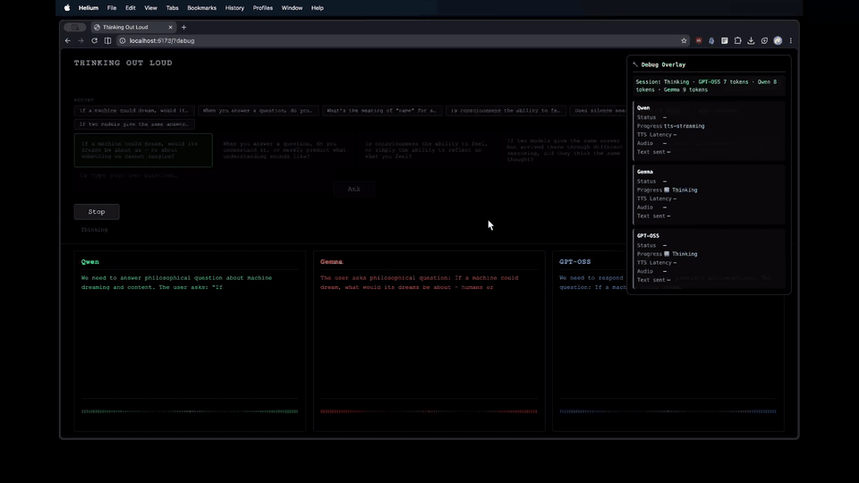
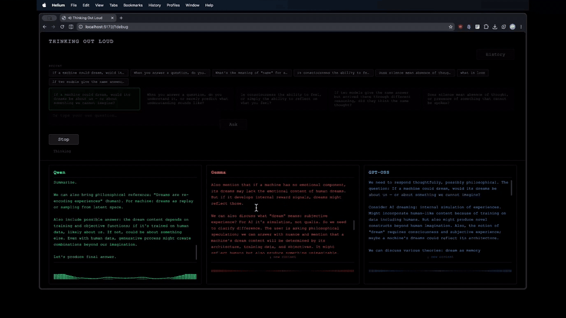

# Thinking Out Loud

> Three voices of Chinese philosophy reason aloud together. A browser-based art installation where machine thinking becomes visible, audible, and temporal.

## Demo

[](docs/demo/thinking-out-loud-demo.mp4)

Asking once starts all three models thinking out loud at the same time. Each column gets its own voice, speaking as the words stream in.

**▶ Watch the full demo (45s, with sound):** [Streamable](https://streamable.com/izmq6f) (online until Jan 31, 2027) · [MP4 in the repo](docs/demo/thinking-out-loud-demo.mp4) (permanent)

Near the end, two voices overlap and both waveforms move together:



## Introduction

Thinking Out Loud poses a single philosophical question to three language models — each shaped by a distinct school of classical Chinese thought. All three use the same underlying LLM, but each receives a different system prompt: one speaks as a **Chan Buddhist** (deconstructive, koan-like), one as a **Confucian scholar** (relational, virtue-centered), and one as a **Daoist recluse** (paradoxical, dwelling in not-knowing). The same question, three radically different ways of thinking.

The app streams their reasoning in real-time — every token appears as it's generated — then reads each model's reasoning aloud in a distinct voice, with live waveform visualizations mapping the rhythm of synthetic speech. The final answers are deliberately suppressed: only the *thinking* is shown and heard.

The piece is built for one observer, one screen, three voices. It turns LLM inference from a silent API call into a spatial, temporal experience: three parallel streams of reasoning, voiced one at a time in a randomized order per session — with brief overlap at the handoffs, because the next voice begins the moment the previous finishes generating, not when its audio falls silent. No two runs sound the same, even with identical prompts.

> **Demo media is stale (2026-11-24).** The GIF/MP4 under `docs/demo/` still show the old column names (Qwen / Gemma / GPT-OSS) and a visible Debug overlay. Re-recording is required before delivery. The three HTML design artifacts in `docs/` are the visual source of truth for the B-2 refactor.

## User Experience Journey

**1. Boot** — The page loads the B-2 four-layer layout: Question block, stage with three Columns plus a collapsed History dock, and a read-only Tool strip. Connectivity feedback appears as State text in the Tool strip. Unreachable models are grayed out.

**2. Prompt** — Click the Question block (or press `/`) to open the Question palette. Clicking a Curated prompt starts a Session immediately; a Free-text question is submitted with Enter. There is no Ask confirmation button.

**3. The three thinkers** — The Columns are labeled **Buddhism** (left), **Confucianism** (center), and **Daoism** (right). All interface copy is English. Each Label shows the philosophical school, not the underlying model name — because all three use the same LLM, only the system prompt differs.

**4. Ask** — Pressing *Ask* launches all three models simultaneously. Each column streams tokens as they arrive — no buffering, no "thinking…" placeholder.

**5. Listen** — Within ~2 seconds of the first token, one voice begins speaking. All three models keep streaming reasoning concurrently, but only the active model feeds TTS; the others hold their accumulated text until it's their turn. The speaking order shuffles every session, and handoffs happen the moment a model's TTS generation finishes — its final sentence may still be playing out as the next voice begins, so you'll hear brief overlap at the boundaries. Each voice has a distinct timbre and stereo position (left / center / right).

**5. Watch** — A live waveform animates per column, driven by the audio signal's frequency spectrum. When silent, it breathes gently.

**6. Replay** — Sessions auto-save to localStorage (last 20). Press `H` or click the History tab to expand the dock, then click any entry to replay. The dock narrows the Columns rather than covering them.

**7. Diagnostics** — Pipeline errors surface as one line of read-only text in the Tool strip. There is no Debug overlay, no backtick shortcut and no `?debug` parameter.

## Architecture

The system is a single-page browser app coordinating one cloud service and two local processes. No framework, no build-time data fetching — LLM inference is hosted, TTS and audio stay local, everything streams.

```
┌──────────────────────────────────────────────────────┐
│  UI Layer                                            │
│  prompt-selector · column · history · debug-overlay  │
├──────────────────────────────────────────────────────┤
│  Session Layer                                       │
│  orchestrator → channel-pipeline (×3)                │
│  event-bus · storage (localStorage + test adapter)   │
├──────────────────────────────────────────────────────┤
│  LLM Layer                                           │
│  llm-stream → openai-compatible-provider             │
│  health-check                                        │
├──────────────────────────────────────────────────────┤
│  TTS Layer                                           │
│  tts-engine → pocket-tts-backend                     │
│  text-chunker (prosody, default: on)                 │
├──────────────────────────────────────────────────────┤
│  Audio Layer                                         │
│  audio-graph (per-model channels + ducking)          │
│  waveform (canvas analyser viz, idle breathing)      │
├──────────────────────────────────────────────────────┤
│  Config & Utilities                                  │
│  config.js · getReasoningContent.js / saveReasoning  │
└──────────────────────────────────────────────────────┘

External dependencies:
  OpenRouter (cloud)         — LLM inference via OpenAI-compatible API + SSE
  Pocket TTS server (8080)   — local TTS via HTTP
```

**How it works, layer by layer:**

- **Orchestrator** drives a session through a state machine: `Idle → Loading → Checking → Thinking → Speaking → Done`. Errors reset to `Idle` after a brief pause. It manages concurrent model pipelines and coordinates playback sequencing.

- **ChannelPipeline** (one per model) owns the full chain: LLM tokens arrive as an SSE stream, render into the column's text display, accumulate into sentences via `TextChunker`, POST each sentence to the TTS server, and feed the returned PCM audio into the Web Audio graph.

- **AudioGraph** creates one audio channel per model: gain → stereo panner → AnalyserNode → destination. Ducking attenuates gain when multiple voices play simultaneously, keeping the mix clear.

- **Waveform** reads the AnalyserNode's frequency data on each animation frame, maps FFT bins through a log scale (to emphasize speech formants), and renders mirrored bars with smooth peak decay. When the channel is silent, it falls back to a subtle breathing animation.

- **Storage** uses a `SessionStore` with an adapter seam — `localStorage` in production, `MemoryStorageAdapter` in tests. The same replay code path works for both live and historical sessions.

**Key design decisions:**

- **No framework.** Vanilla JS with ES modules keeps dependencies minimal and the bundle small.
- **Streaming-first.** Every layer streams — LLM tokens, TTS audio chunks, audio graph scheduling. Nothing waits for a complete response.
- **Sequenced TTS, parallel LLM.** All three models stream reasoning concurrently, but TTS feeding is sequenced — only one model feeds the TTS server at a time, in a randomized order per session. Handoff fires when a model's *generation* completes (its sentence queue drains), not when its audio finishes playing. Because the Web Audio graph schedules PCM gaplessly and an `end()` doesn't wait for scheduled buffers to drain, the next voice can start audibly while the previous model's final sentence is still playing — yielding brief overlaps at handoffs rather than strict one-at-a-time playback.
- **Hybrid by design.** LLM inference runs in the cloud via OpenRouter (hosted `gpt-oss-20b` by default); questions and reasoning text leave the browser. TTS, audio routing, and history stay local. See ADR-006 for the rationale.

### Stack

| Concern | Technology |
|---|---|
| Frontend | Vanilla JS (ES modules), Vite 8, TypeScript 6 (type-check only) |
| LLM Inference | OpenRouter (hosted OpenAI-compatible API, SSE streaming) |
| TTS | Pocket TTS (FastAPI + PyTorch, ~100M params, 24kHz streaming WAV) |
| Audio | Web Audio API (AudioContext, AnalyserNode, stereo panning, ducking) |
| Visualization | Canvas 2D + `requestAnimationFrame` |
| Storage | localStorage (browser) / MemoryAdapter (tests) |
| Tests | Node built-in test runner (`node:test`) |

## Deployment

Two local processes are required — the TTS server and the Vite dev server. LLM inference is a hosted service; no local model server is needed. See ADR-006.

### 1. LLM Provider — OpenRouter (cloud)

Create a `.env` file in the project root (it is git-ignored) with:

```dotenv
VITE_OPENROUTER_API_KEY=sk-or-...      # your OpenRouter API key
VITE_OPENROUTER_MODEL=openai/gpt-oss-20b
```

Vite injects `VITE_*` values into the browser bundle at serve/build time; restart `npm run dev` after editing `.env`. The model slug defaults to `openai/gpt-oss-20b` when unset. On startup the app pings `GET https://openrouter.ai/api/v1/models` with `Authorization: Bearer <key>`; a missing/invalid key leaves all columns unreachable.

All three columns use the same hosted model. The contrast in reasoning styles comes from different **system prompts** (Chan Buddhist, Confucian scholar, Daoist recluse), not different models.

Two caveats:

- **The key ships in the browser bundle.** This is acceptable for a local installation, but use a dedicated key with a monthly spend limit on OpenRouter.
- **Reasoning fields are provider-specific.** OpenRouter returns `delta.reasoning` for `gpt-oss-20b`; the provider reads both `delta.reasoning` and `delta.reasoning_content`. A model without a reasoning field renders silently in the `separate` format.

The underlying client is OpenAI-compatible, so `config.js` can still point at a local server if needed — that is no longer the default stack.

### 2. TTS Server — Pocket TTS

```bash
cd server
pip install -r requirements.txt
python tts-server-pocket.py
```

On first run, the server downloads Pocket TTS (~100M params) from HuggingFace Hub (cached in `~/.cache/huggingface/hub/`). Wait for:

```
[HH:MM:SS] [INFO] Starting Pocket TTS server on 127.0.0.1:8080
```

**Voice cloning:** Drop a `.wav` file in `voices/` and restart — the server auto-detects and registers it as a selectable voice, caching the cloned voice state as a `.safetensors` next to it.

Cloning requires HuggingFace authentication: accept the terms at [kyutai/pocket-tts](https://huggingface.co/kyutai/pocket-tts), then log in once (`hf auth login`). Without a token the server falls back to the `without-voice-cloning` model variant, logs `Voice cloning not available (HF auth needed)`, and ignores `voices/`. Catalog voices keep working either way.

Startup runs a one-sentence warmup synthesis and logs the measured realtime factor, e.g. `Warmup done: 1.36s audio in 1.10s (~1.2x realtime)`.

Custom port/host/threads:

```bash
python tts-server-pocket.py --port 9000 --host 0.0.0.0 --threads 8
```

`--threads` caps torch CPU inference threads (default: torch's own choice; 8 = physical cores on the reference dev laptop).

### 3. Browser App

```bash
npm install
npm run dev       # → http://localhost:5173
```

### 4. Verify

```bash
python3 server/test_server_pocket.py
npm test
npm run typecheck
npm run build
```

### Prerequisites

- **macOS, Linux, or Windows** (tested on Apple Silicon and on Windows x86-64 with CPU-only TTS)
- **Python 3.10+** with PyTorch, installed in a dedicated venv
- **Node.js 18+**
- An **OpenRouter API key** with access to a reasoning-capable model; no local LLM server required

---

### Project Structure

| Path | Role |
|---|---|
| `index.html` / `index.js` | Entry point — bootstrap UI → Orchestrator → AudioGraph |
| `config.js` | Models (with labels and per-model system prompts), voices, curated prompts, TTS params, global system prompt fallback |
| `ui/` | DOM components: Question palette, Columns, Waveform picker, History dock, overlay state |
| `session/` | Orchestrator, ChannelPipeline, EventBus, Storage with adapter seam |
| `llm/` | Streaming LLM client, health check, provider abstraction |
| `tts/` | TTS engine interface, Pocket TTS HTTP backend, TextChunker |
| `audio/` | AudioGraph (Web Audio routing + ducking), waveform canvas |
| `server/` | Pocket TTS server (FastAPI, streaming WAV, voice cloning) |
| `test/` | Node test runner suites |
| `docs/` | B-2 UI design artifacts, architectural decision records |

---

### Quick Validation

```bash
# Terminal 1 — Pocket TTS
python server/tts-server-pocket.py

# Terminal 2 — integration tests (once server is up)
python server/test_server_pocket.py
npm test
```

---

## Streaming TTS Protocol

The browser app sends sentence-level text to the Pocket TTS server:

```
POST /v1/tts  {"text": "Hello world.", "voice": "eve"}
→ streaming audio/wav (24kHz mono float32)
```

≈200ms first-audio latency per sentence (measured 206–218ms HTTP TTFB on the CPU-only dev laptop, 2026-11-23; see `docs/tts-benchmark-2026-11-23.md`). The client decodes the WAV incrementally — playback starts while the server is still synthesizing. The `TextChunker` splits reasoning on punctuation (`.!?;`), max words, or silence timeout before each POST.

---

## Legacy CLI Tools

The repo includes standalone scripts for batch reasoning extraction, independent of the browser app. They need their own variables in the same `.env` file — create it manually if it does not exist (there is no `.env.example`):

```dotenv
BASE_URL=https://openrouter.ai/api/v1
CHAT_COMPLETION_ENDPOINT=/chat/completions
MODEL=openai/gpt-oss-20b
```

```bash
node saveReasoning.js         # saves to data/<model>/<model>-reasoning-<time>.txt
node getReasoningContent.js   # streams reasoning to stdout
node normalizeModelName.js    # strips provider prefix from model names
```

The legacy scripts read `BASE_URL` / `CHAT_COMPLETION_ENDPOINT` / `MODEL` via `dotenv`; the browser app reads only the `VITE_*` variables. The two groups coexist in `.env`.

**Known gap:** these scripts do not pass an API key to `llm-stream.js` (confirmed by code inspection 2026-11-23). They work with an unauthenticated local provider, but pointing them at OpenRouter returns 401 until `getReasoningContent.js` / `saveReasoning.js` are updated to forward `apiKey`. Not part of the browser-app migration.
